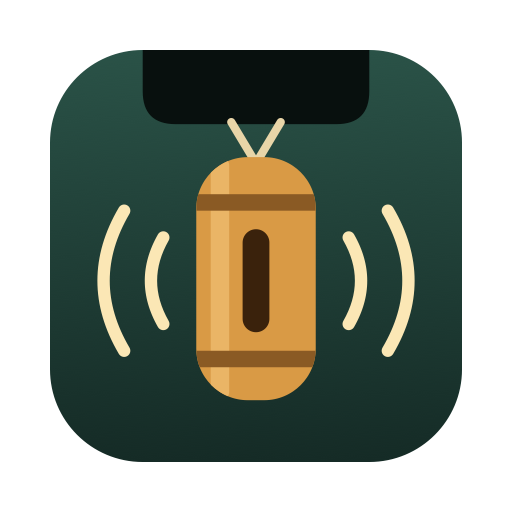

<p align="center">
  
</p>

<h1 align="center">Kentongan</h1>

<p align="center">Notch buatan untuk Mac tanpa notch: notifikasi dan musik nongol dari tengah atas layar.</p>

Dulu kentongan dipakai di kampung untuk memberi kabar. Yang ini tugasnya sama, hanya saja digantung di atas layar Mac.

## Fitur

- **Notifikasi** dari banner macOS, lengkap dengan ikon aplikasi. Yang masuk bersamaan diantre.
- **Klik notifikasi** untuk membukanya.
- **Banner bawaan disembunyikan** (bisa dimatikan dari menu). Notifikasi jenis Alert tetap tampil, supaya tombolnya bisa dipakai.
- **Musik:** judul, artis, aplikasi sumber, garis progres, serta tombol sebelumnya, play/pause, dan berikutnya.
- **Tampilan kaca** dengan animasi pegas.

## Kebutuhan

- Dibuat dan dicoba di **macOS 13 Ventura pada iMac Intel**. Versi macOS dan Mac lain belum dicoba.
- Command Line Tools (`xcode-select --install`). Xcode tidak diperlukan.
- `build.sh` menghasilkan app untuk Intel (`x86_64`).

## Build dan jalankan

```bash
./build.sh
```

```bash
open build/NotchProto.app
```

Lalu aktifkan **NotchProto** di **System Settings → Privacy & Security → Accessibility**.

Untuk mengirim notifikasi uji saat app sedang berjalan:

```bash
./test.sh
```

### Supaya izin tidak lepas setiap build

Tanpa sertifikat, app ditandatangani secara ad-hoc dan izin Accessibility bisa harus diberikan lagi setelah build ulang. `build.sh` otomatis memakai sertifikat code signing bernama **`NotchProto Local Signing`** jika ada di Keychain. Sertifikat ini bisa dibuat lewat **Keychain Access → Certificate Assistant → Create a Certificate**, dengan tipe **Code Signing**.

### Nyala otomatis saat login

Tambahkan `build/NotchProto.app` di **System Settings → General → Login Items**.

## Privasi

- Teks notifikasi hanya disimpan di memori selama app berjalan.
- `~/Library/Logs/NotchProto.log` mencatat waktu, status, nama aplikasi pengirim, dan struktur elemen banner, tanpa isi notifikasi.
- Kode ini tidak melakukan koneksi jaringan.
- Izin Accessibility itu luas: app yang memegangnya bisa membaca dan mengendalikan app lain. Baca kodenya sebelum memberi izin.
- Isi notifikasi tampil di tengah atas layar. Hati-hati saat berbagi layar.

## Keterbatasan

- Info musik memakai framework **privat** `MediaRemote`. Sejak macOS 15.4, Apple tidak lagi memberikan data ini ke aplikasi pihak ketiga.
- Notifikasi dibaca dari susunan elemen Notification Center. Pembaruan macOS bisa mengubahnya.
- Ini bukan pengganti resmi sistem notifikasi macOS. Notifikasi yang ditahan Focus atau Do Not Disturb tidak muncul.
- Jika terbaca lebih dari tiga banner sekaligus, banner bawaan tidak disembunyikan.
- Label sumber musik menampilkan nama aplikasi (misalnya browser), bukan nama situsnya.
- Cover album hanya tampil jika aplikasi pemutar mengirimkannya.

## Struktur

| File | Isi |
|---|---|
| `Sources/main.swift` | Jendela, menu, antrean, hover |
| `Sources/IslandView.swift` | Tampilan |
| `Sources/GlassContainer.swift` | Blur dan animasi pegas |
| `Sources/BannerWatcher.swift` | Membaca dan menyembunyikan banner |
| `Sources/MenuBarIcon.swift` | Ikon di menu bar |
| `Sources/SourceApp.swift` | Mengenali aplikasi dan ikonnya |
| `Sources/NowPlaying.swift` | Info dan kontrol musik |
| `scripts/make-icon.swift` | Menggambar ikon app |

Nama internal app dan bundle masih `NotchProto`, nama awal saat prototipe.

## Lisensi

[MIT](LICENSE)
